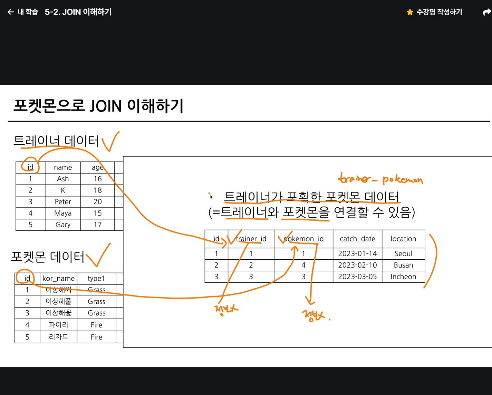

# 📘 SQL_BASIC 6주차 정규 과제

SQL_BASIC 정규 과제는 매주 정해진 분량의 `초보자를 위한 BigQuery(SQL) 입문` 강의를 듣고, 핵심 개념을 정리한 뒤 간단한 SQL 문제를 직접 풀어보는 방식으로 진행합니다.

이번 주는 SQL 입문 과정의 핵심 고비인 `JOIN`을 학습합니다.

JOIN은 여러 테이블을 연결해서 분석 질문에 답하기 위해 반드시 필요한 개념입니다. 이번 주 과제에서는 정답 코드뿐 아니라 **어떤 테이블을 어떤 키로 연결했는지**를 꼭 기록해주세요.

완성된 과제는 Github에 업로드하고, 링크를 스프레드시트 'SQL' 시트에 입력해 제출해주세요.

**👀 수행 인증란은 필수입니다.**

---

## 📚 SQL_BASIC_6th_TIL

### 섹션 6. 다량의 자료를 연결 : JOIN

### 5-2. JOIN 이해하기

### 5-3. 다양한 JOIN 방법

### 5-4. JOIN 쿼리 작성하기

### 5-5. JOIN을 처음 공부할 때 헷갈리는 부분

---

## ✨ 선택 강의

- 5-6. JOIN 연습문제: JOIN 문제를 더 연습하고 싶을 때 선택 수강

---

## 🏁 전체 강의 수강 계획

| 주차 | 필수 강의 범위 | 선택 강의 | 완료 여부 |
| --- | --- | --- | --- |
| 1주차 | 1-1 ~ 2-1 | 1 | ✅ |
| 2주차 | 2-2 ~ 2-3 | 2-4 | ✅ |
| 3주차 | 2-5, 2-7 ~ 2-8 | 2-6 | ✅ |
| 4주차 | 3-2 ~ 4-3 | 3-4 | ✅ |
| 5주차 | 4-4 ~ 4-6 | 4-5, 4-7 | ✅ |
| 6주차 | 5-2 ~ 5-5 | 5-6 | ✅ |
| 7주차 | 필수 강의 없음 | 6-2, 6-3, 6-4, 6-5 | 🍽️ |

---

<br>

<!-- 여기까진 그대로 둬 주세요-->

---

# 1️⃣ 개념 정리

아래 키워드 중 중요하다고 생각한 개념을 2개 이상 골라 짧게 정리해주세요. 3개보다 더 많이 정리하고 싶다면 자유롭게 항목을 추가해도 좋습니다.

이번 주 키워드:
- JOIN
- INNER JOIN
- LEFT JOIN
- JOIN key
- alias
- NULL
- 다중 JOIN

## 01.

```
개념 이름: INNER JOIN
개념 설명: 두 테이블에서 JOIN 조건에 일치하는 행만 연결해 반환하는 방법이다. 한쪽 테이블에만 존재하거나 JOIN key가 일치하지 않는 행은 결과에서 제외된다.
예시 쿼리:
SELECT b.book_id, a.author_name
FROM book AS b
INNER JOIN author AS a
  ON b.author_id = a.author_id;
```

## 02.

```
개념 이름: LEFT JOIN
개념 설명: 왼쪽 테이블의 모든 행을 유지하고, 오른쪽 테이블에서 JOIN 조건에 맞는 행을 연결하는 방법이다. 오른쪽에 일치하는 행이 없으면 오른쪽 테이블의 컬럼은 NULL로 표시된다.
예시 쿼리:
SELECT i.animal_id, o.animal_id AS out_animal_id
FROM animal_ins AS i
LEFT JOIN animal_outs AS o
  ON i.animal_id = o.animal_id;
```

## (선택) 03.

```
개념 이름: JOIN key
개념 설명: 두 테이블에서 서로 관련된 행을 찾기 위해 ON 절에서 비교하는 컬럼이다. 보통 한 테이블의 기본 키와 다른 테이블의 외래 키를 연결한다.
헷갈린 점: 컬럼 이름이 같다고 항상 같은 의미의 키인 것은 아니므로, 테이블 관계와 컬럼의 의미를 확인한 뒤 연결해야 한다.
```

---

# 2️⃣ 수행 인증란



---

# 3️⃣ 확인 문제

프로그래머스는 로그인이 필요하므로, 로그인 후 문제 풀이를 진행해주세요.

## 🧩 문제 1

문제 링크: [조건에 맞는 도서와 저자 리스트 출력하기](https://school.programmers.co.kr/learn/courses/30/lessons/144854)

풀이 과정:

```
- 사용한 테이블: BOOK, AUTHOR
- JOIN key: BOOK.AUTHOR_ID = AUTHOR.AUTHOR_ID
- 날짜를 출력한 형식: DATE_FORMAT(BOOK.PUBLISHED_DATE, '%Y-%m-%d')
- 정답 쿼리:
SELECT b.BOOK_ID, a.AUTHOR_NAME,
       DATE_FORMAT(b.PUBLISHED_DATE, '%Y-%m-%d') AS PUBLISHED_DATE
FROM BOOK AS b
INNER JOIN AUTHOR AS a
  ON b.AUTHOR_ID = a.AUTHOR_ID
WHERE b.CATEGORY = '경제'
ORDER BY b.PUBLISHED_DATE;
```

<!-- 정답을 맞추게 되면, 정답입니다. 이 부분을 캡처해서 이 주석을 지우시고 첨부해주시면 됩니다. -->

## 🧩 문제 2

문제 링크: [상품 별 오프라인 매출 구하기](https://school.programmers.co.kr/learn/courses/30/lessons/131533)

풀이 과정:

```
- 연결한 테이블: PRODUCT, OFFLINE_SALE
- JOIN key: PRODUCT.PRODUCT_ID = OFFLINE_SALE.PRODUCT_ID
- 집계한 값: 상품별 판매액의 합계(SALES_AMOUNT * PRICE)
- 정답 쿼리:
SELECT p.PRODUCT_CODE,
       (p.PRICE * SUM(s.SALES_AMOUNT)) AS SALES
FROM PRODUCT AS p
INNER JOIN OFFLINE_SALE AS s
  ON p.PRODUCT_ID = s.PRODUCT_ID
GROUP BY p.PRODUCT_ID, p.PRODUCT_CODE, p.PRICE
ORDER BY SALES DESC, p.PRODUCT_CODE;
```

<!-- 정답을 맞추게 되면, 정답입니다. 이 부분을 캡처해서 이 주석을 지우시고 첨부해주시면 됩니다. -->

## 🧩 문제 3

문제 링크: [없어진 기록 찾기](https://school.programmers.co.kr/learn/courses/30/lessons/59042)

풀이 과정:

```
- 기준이 되는 왼쪽 테이블: ANIMAL_INS
- LEFT JOIN이 필요한 이유: 입양 기록이 있는 동물과 연결하되, 입양 기록이 없는 동물도 결과에 남겨야 하기 때문이다.
- NULL이 발생하는 경우: ANIMAL_INS의 동물과 일치하는 ANIMAL_OUTS 행이 없을 때 ANIMAL_OUTS의 컬럼이 NULL이 된다.
- 정답 쿼리:
SELECT i.ANIMAL_ID, i.NAME
FROM ANIMAL_INS AS i
LEFT JOIN ANIMAL_OUTS AS o
  ON i.ANIMAL_ID = o.ANIMAL_ID
WHERE o.ANIMAL_ID IS NULL
ORDER BY i.ANIMAL_ID;
```

<!-- 정답을 맞추게 되면, 정답입니다. 이 부분을 캡처해서 이 주석을 지우시고 첨부해주시면 됩니다. -->

## 🧩 문제 4

문제 링크: [있었는데요 없었습니다](https://school.programmers.co.kr/learn/courses/30/lessons/59043)

풀이 과정:

```
- 사용한 테이블: ANIMAL_INS, ANIMAL_OUTS
- JOIN key: ANIMAL_INS.ANIMAL_ID = ANIMAL_OUTS.ANIMAL_ID
- 비교한 날짜 컬럼: ANIMAL_INS.DATETIME, ANIMAL_OUTS.DATETIME
- 정렬 기준: ANIMAL_INS.DATETIME 오름차순
- 정답 쿼리:
SELECT i.ANIMAL_ID, i.NAME
FROM ANIMAL_INS AS i
INNER JOIN ANIMAL_OUTS AS o
  ON i.ANIMAL_ID = o.ANIMAL_ID
WHERE i.DATETIME > o.DATETIME
ORDER BY i.DATETIME;
```

<!-- 정답을 맞추게 되면, 정답입니다. 이 부분을 캡처해서 이 주석을 지우시고 첨부해주시면 됩니다. -->

---

# 4️⃣ 참고 자료

JOIN 개념이 헷갈린다면 아래 자료를 함께 참고해도 좋습니다.

1. https://data-marketing-bk.tistory.com/entry/SQL-JOIN-%ED%95%9C-%EB%B0%A9%EC%97%90-%EC%A0%95%EB%A6%AC-%EA%B0%9C%EB%85%90%EB%B6%80%ED%84%B0-%EC%BD%94%EB%93%9C%EA%B9%8C%EC%A7%80-%EC%9D%B4%EA%B2%83%EB%A7%8C-%EB%B3%B4%EC%9E%90
2. https://velog.io/@wijoonwu/JOIN

---

# 5️⃣ 이번 주 회고

```
1. INNER JOIN과 LEFT JOIN의 차이를 어떻게 이해했는지:
2. JOIN 문제를 풀 때 가장 먼저 확인해야 할 것:
3. JOIN 결과가 예상과 달랐던 경험이 있다면:
```

수고하셨습니다!


