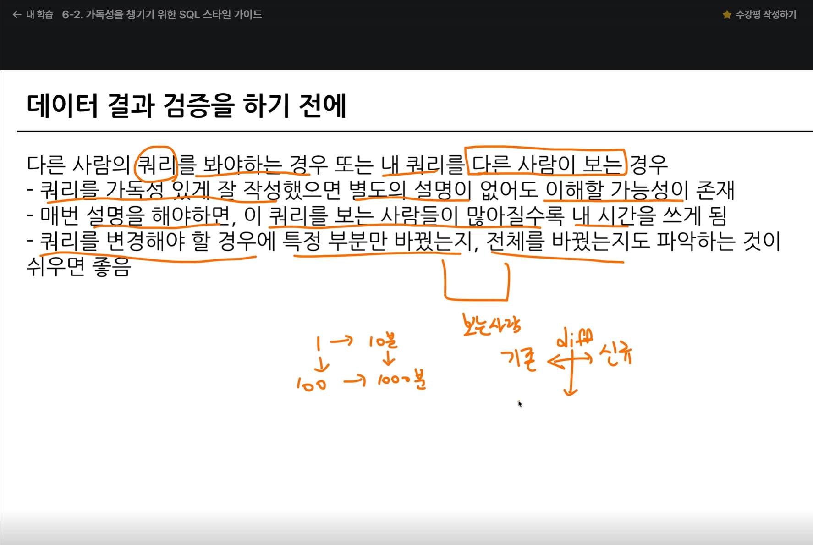

# 📘 SQL_BASIC 7주차 정규 과제

이번 주 필수 강의는 없습니다.

이번 주는 지금까지 배운 SQL 내용을 가볍게 복습하는 것으로 마무리합니다. 문제 풀이보다 중요한 것은 **내가 어떤 SQL 개념을 익혔고, 아직 어떤 부분이 헷갈리는지 정리하는 것**입니다.

완성된 과제는 Github에 업로드하고, 링크를 스프레드시트 'SQL' 시트에 입력해 제출해주세요.

**👀 수행 인증란은 필수입니다.**

---

## 📚 SQL_BASIC_7th_REVIEW

---

## ✨ 선택 강의

- 6-2. 가독성을 챙기기 위한 SQL 스타일 가이드: SQL을 더 읽기 좋게 작성하고 싶을 때 선택 수강
- 6-3. 가독성을 챙기기 위한 WITH 문 & 파티션: WITH 문과 파티션 개념을 가볍게 살펴보고 싶을 때 선택 수강
- 6-4. 데이터 결과 검증 정의: 쿼리 결과를 검증하는 관점을 알고 싶을 때 선택 수강
- 6-5. 데이터 결과 검증 예시: 결과 검증 사례를 확인하고 싶을 때 선택 수강

---

## 🏁 전체 강의 수강 계획

| 주차 | 필수 강의 범위 | 선택 강의 | 완료 여부 |
| --- | --- | --- | --- |
| 1주차 | 1-1 ~ 2-1 | 1 | ✅ |
| 2주차 | 2-2 ~ 2-3 | 2-4 | ✅ |
| 3주차 | 2-5, 2-7 ~ 2-8 | 2-6 | ✅ |
| 4주차 | 3-2 ~ 4-3 | 3-4 | ✅ |
| 5주차 | 4-4 ~ 4-6 | 4-5, 4-7 | ✅ |
| 6주차 | 5-2 ~ 5-5 | 5-6 | ✅ |
| 7주차 | 필수 강의 없음 | 6-2, 6-3, 6-4, 6-5 | ✅ |

---

<br>

<!-- 여기까진 그대로 둬 주세요-->

---

## 🔁 복습할 개념

- SELECT, FROM, WHERE
- ORDER BY, LIMIT
- GROUP BY, HAVING
- COUNT, SUM, AVG, MAX, MIN
- 문자열 함수
- 날짜/시간 함수
- CASE WHEN
- JOIN

---

# 1️⃣ 전체 개념 복습

아래 키워드 중 중요하다고 생각한 개념을 2개 이상 골라 짧게 정리해주세요. 3개보다 더 많이 정리하고 싶다면 자유롭게 항목을 추가해도 좋습니다.

복습 키워드:
- SELECT
- WHERE
- GROUP BY
- HAVING
- 문자열 함수
- 날짜/시간 함수
- CASE WHEN
- JOIN

## 01.

```
개념 이름: WHERE
개념 설명: WHERE는 행을 그룹화하거나 집계하기 전에, 조건에 맞는 행만 골라냅니다. 여러 조건은 AND 또는 OR로 연결할 수 있습니다.
예시 쿼리:
SELECT ANIMAL_ID, NAME
FROM ANIMAL_INS
WHERE ANIMAL_TYPE = 'Cat';
```

## 02.

```
개념 이름: GROUP BY와 HAVING
개념 설명: GROUP BY는 같은 값을 가진 행을 그룹으로 묶고, HAVING은 집계한 그룹에 조건을 적용합니다. 개별 행을 거르는 WHERE와 구분해서 사용합니다.
예시 쿼리:
SELECT NAME, COUNT(*) AS COUNT
FROM ANIMAL_INS
WHERE NAME IS NOT NULL
GROUP BY NAME
HAVING COUNT(*) >= 2;
```

## (선택) 03.

```
개념 이름: JOIN
개념 설명: JOIN은 두 테이블에서 서로 연결되는 행을 결합합니다. ON에 연결할 기준을 적고, INNER JOIN은 양쪽에 모두 일치하는 행을 반환합니다.
아직 헷갈리는 점: 여러 테이블을 JOIN할 때 각 테이블의 컬럼 이름이 겹치면 테이블 별칭을 붙여 구분해야 합니다.
예시 쿼리:
SELECT o.ORDER_ID, c.CUSTOMER_NAME
FROM ORDERS AS o
INNER JOIN CUSTOMERS AS c
    ON o.CUSTOMER_ID = c.CUSTOMER_ID;
```

### 복습 한눈에 보기

| 개념 | 역할 | 기억할 점 |
| --- | --- | --- |
| SELECT, FROM | 조회할 컬럼과 테이블 지정 | 어떤 데이터를 어느 테이블에서 가져올지 정합니다. |
| WHERE | 행 단위 조건 필터링 | GROUP BY와 집계보다 먼저 적용됩니다. |
| GROUP BY | 기준 컬럼별로 행 묶기 | 그룹별 집계 결과를 만들 때 사용합니다. |
| HAVING | 그룹 결과 필터링 | COUNT, SUM 같은 집계 조건에 사용합니다. |
| ORDER BY, LIMIT | 결과 정렬과 개수 제한 | 정렬 기본값은 오름차순이며, 내림차순은 DESC입니다. |
| COUNT, SUM, AVG, MAX, MIN | 그룹 또는 전체 데이터 집계 | GROUP BY와 함께 쓰면 그룹별 결과를 구합니다. |
| 문자열 함수 | 문자열 자르기·변환·결합 | 함수별 인자 순서와 반환값을 확인합니다. |
| 날짜/시간 함수 | 날짜 계산 및 단위 추출 | 날짜 조건의 범위와 시간 단위를 주의합니다. |
| CASE WHEN | 조건에 따른 값 분기 | 조건을 위에서부터 검사하고 ELSE로 나머지를 처리할 수 있습니다. |
| JOIN | 테이블 간 행 결합 | ON 조건과 JOIN 종류에 따라 결과 행이 달라집니다. |

일반적인 작성 순서는 `SELECT → FROM/JOIN → WHERE → GROUP BY → HAVING → ORDER BY → LIMIT`입니다. SQL은 이 순서대로 작성하지만, 실제 처리는 FROM과 JOIN, WHERE, GROUP BY, HAVING, SELECT, ORDER BY, LIMIT 순서로 이해하면 필터와 집계의 차이를 파악하기 쉽습니다.

---

# 2️⃣ 수행 인증란


---

# 3️⃣ 복습 문제

프로그래머스는 로그인이 필요하므로, 로그인 후 문제 풀이를 진행해주세요.

## 🧩 문제 1

문제 링크: [여러 기준으로 정렬하기](https://school.programmers.co.kr/learn/courses/30/lessons/59404)

풀이 과정:

```
- 문제 요구사항: 동물 보호소에 들어온 동물의 이름과 보호 시작일을 조회하고, 이름 오름차순으로 정렬합니다. 이름이 같으면 보호 시작일을 내림차순으로 정렬합니다.
- 첫 번째 정렬 기준: NAME 오름차순(ASC)
- 두 번째 정렬 기준: DATETIME 내림차순(DESC)
- 복습한 점: ORDER BY에 정렬 기준을 쉼표로 이어서 적습니다. 앞에 적은 기준을 먼저 적용하고, 같은 값인 행에 다음 기준을 적용합니다.
- 정답 쿼리:
SELECT ANIMAL_ID, NAME, DATETIME
FROM ANIMAL_INS
ORDER BY NAME ASC, DATETIME DESC;
```


## 🧩 문제 2

문제 링크: [동명 동물 수 찾기](https://school.programmers.co.kr/learn/courses/30/lessons/59041)

풀이 과정:

```
- 그룹화 기준: NAME
- 제외해야 하는 값: 이름이 NULL인 행
- HAVING 조건: 같은 이름이 2번 이상 등장하는 그룹, 즉 COUNT(*) >= 2
- 복습한 점: NULL 이름은 WHERE NAME IS NOT NULL로 먼저 제외하고, 그룹별 개수 조건은 HAVING에 작성합니다.
- 정답 쿼리:
SELECT NAME, COUNT(*) AS COUNT
FROM ANIMAL_INS
WHERE NAME IS NOT NULL
GROUP BY NAME
HAVING COUNT(*) >= 2
ORDER BY NAME;
```


---

# 4️⃣ 최종 회고

7주 동안 SQL BASIC 과제를 진행하며 느낀 점을 자유롭게 작성해주세요.

```
1. SQL을 배우기 전과 비교했을 때 달라진 점: 필요한 데이터를 조건에 맞게 직접 조회하고, 정렬하거나 그룹별로 요약하는 방법을 알게 되었습니다. 문제를 보면 어떤 테이블과 컬럼이 필요한지 나누어 생각하게 되었습니다.
2. 가장 도움이 되었던 과제 또는 문제 유형: GROUP BY와 집계 함수를 함께 사용해 그룹별 개수나 합계를 구하는 문제였습니다. WHERE와 HAVING의 역할 차이를 연습할 수 있었습니다.
3. 가장 어려웠던 개념: 여러 테이블을 JOIN할 때 연결 기준을 정하고, 같은 이름의 컬럼을 구분하는 부분이 가장 어려웠습니다. 작은 예시로 테이블별 행과 결과를 확인하며 익히고 싶습니다.
4. 앞으로 데이터 분석이나 프로젝트에서 SQL을 어떻게 활용해보고 싶은지: 실제 데이터에서 필요한 행과 컬럼을 추출하고, 기간·유형별 지표를 집계해 분석이나 시각화에 활용해보고 싶습니다. 결과를 샘플 데이터와 대조해 검증하는 습관도 들이겠습니다.
5. SQL BASIC 과제에 대한 피드백: 주차별로 개념을 나누어 연습할 수 있어 좋았습니다. 각 주차에 자주 헷갈리는 부분을 비교하는 짧은 요약과 추가 연습 문제가 함께 있으면 복습에 더 도움이 될 것 같습니다.
```

정말 수고하셨습니다!


